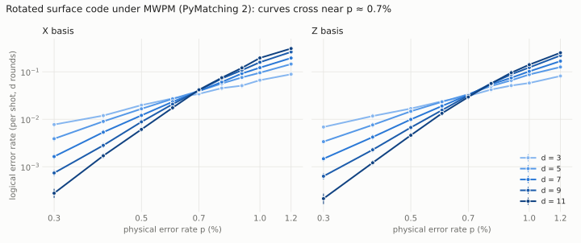
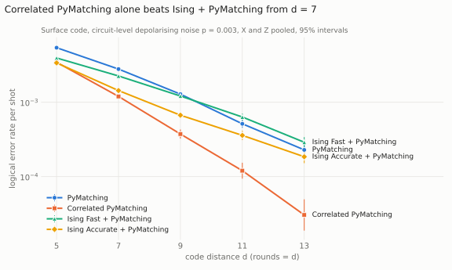

# parity

**An open, independent benchmark for quantum error-correction decoders.**

A quantum computer only works if its decoder can keep up: every round of syndrome extraction must
be decoded, accurately, faster than the hardware produces it. Decoder papers and vendor
announcements report accuracy and speed on different circuits, noise models, hardware and
shot counts, so their numbers cannot be compared directly. parity measures every decoder on the
same circuits, the same noise, the same seeds and the same machine, and publishes the scripts so
anyone can rerun any number.

Rules the benchmark keeps:

- **Same inputs for everyone.** Circuits are generated by [Stim](https://github.com/quantumlib/Stim)
  from a fixed specification; detector samples are seeded and reused across decoders.
- **Reproduce before comparing.** Each decoder is first run against its own published claim, under
  the protocol its authors describe, before it appears in any comparison.
- **Report the machine.** Every result records CPU/GPU, library versions, seeds and shot counts.
- **Publish the losses too.** Results that do not reproduce are reported as "not reproduced on
  this hardware", with the measurement, never as a claim that the original is wrong.

## Status

Milestones M0 and M1 are complete; M2 is next.

| Milestone | Scope | Status |
|---|---|---|
| M0 | Reproduce PyMatching 2 / Sparse Blossom ([Higgott & Gidney, arXiv:2303.15933](https://arxiv.org/abs/2303.15933)): speed at d=17, p=0.1%; logical error rates and threshold for the rotated surface code | done: scaling reproduced; threshold crossings measured; absolute speed needs comparable hardware |
| M1 | Independent check of NVIDIA's Ising pre-decoders ([arXiv:2604.12841](https://arxiv.org/abs/2604.12841)): logical error rate and latency of pre-decoder + PyMatching against uncorrelated and correlated PyMatching alone, on identical Stim samples | done: see M1 below |
| M2 | Suite: surface, colour and qLDPC codes; PyMatching, Union-Find, Fusion Blossom, BP-OSD, Chromobius and others; public leaderboard with submissions by pull request | planned |

## M0: Sparse Blossom speed

The paper's protocol (Section 6): rotated surface-code memory circuits with circuit-level
depolarising noise, rounds = distance, time to decode divided by the number of rounds, one
million shots, one core of an Apple M1 Max. Reported: a mean of 0.62 µs per round at d=17,
p=0.1%, under 1 µs per round in each of the X and Z bases.

[`bench/m0_sparse_blossom_speed.py`](bench/m0_sparse_blossom_speed.py) follows that protocol:
Stim-generated circuits, decoding timed separately from sampling, each basis timed on its own,
bit-packed batches on one thread.

```bash
python -m venv .venv && .venv/bin/pip install -r requirements.txt
.venv/bin/python bench/m0_sparse_blossom_speed.py --distance 17 --p 0.001 --shots 1000000 \
    --out results/m0_d17_p0.001.json
```

### Results so far

Measured on one core of a 4-core Intel Xeon VM @ 2.80 GHz (Linux), Stim 1.16.0, PyMatching 2.4.0.

**Absolute speed: not reproduced on this machine; the gap is consistent with the hardware.**
d=17, p=0.1%, rounds=17, one million shots per basis
([`results/m0_d17_p0.001.json`](results/m0_d17_p0.001.json)):

| | X basis | Z basis | Paper (Apple M1 Max) |
|---|---|---|---|
| µs per round | 2.12 | 2.13 | 0.62 (mean) |
| logical errors | 0 / 1,000,000 | 0 / 1,000,000 | |

This VM is 3.4× slower than the paper's figure. A single core of an M1 Max is considerably faster
than this virtualised Xeon core, so the absolute number cannot settle the claim either way; it
needs a run on comparable hardware.

**Scaling: reproduced.** Claims that do not depend on the CPU, checked with
[`bench/m0_scaling.py`](bench/m0_scaling.py) (X basis, rounds = d, d = 5 to 29;
[`results/m0_scaling.json`](results/m0_scaling.json)):

| Claim (paper) | Paper | Measured here |
|---|---|---|
| Time per round, d=29 ÷ d=17, p=0.1% | 3.5 / 0.62 = 5.6× | 12.51 / 2.03 = 6.2× |
| Exponent of decode time vs number of detectors, p=1% | 1.32 | 1.38 |
| Exponent at p=0.5% | "roughly linear" | 1.27 |
| Exponent at p=0.1% | "roughly linear" | 1.20 |

The fitted exponent is the slope of log(decode time per shot) against log(number of detectors).
The paper's own two p=0.1% data points (d=17 and d=29) imply an exponent of about 1.4 over that
range, so "roughly linear" and the 1.20 measured here over d = 5 to 29 are consistent.

**Threshold: measured.** Logical error rate against physical error rate for d = 3 to 11,
rounds = d, both bases, up to 1,000 logical errors or one million shots per point, sampled and
decoded with sinter ([`bench/m0_threshold.py`](bench/m0_threshold.py);
[`results/m0_threshold.json`](results/m0_threshold.json), 95% intervals included):

<picture>
  <source media="(prefers-color-scheme: dark)" srcset="results/m0_threshold_dark.svg">
  
</picture>

| Pair of distances | 3 / 5 | 5 / 7 | 7 / 9 | 9 / 11 |
|---|---|---|---|---|
| Crossing, X basis | 0.61% | 0.71% | 0.67% | 0.69% |
| Crossing, Z basis | 0.62% | 0.72% | 0.74% | 0.80% |

Below the crossing, each step up in distance suppresses logical errors; above it, larger codes do
worse. For the larger pairs the crossings sit between 0.67% and 0.80%. The Z-basis crossings still
drift upward with distance, so a sharper estimate needs larger distances and more shots; this is
reported as measured, not as a fitted threshold.

Every number above can be regenerated with the commands in this README; the JSON files record
the seeds, shot counts, library versions and CPU.

## M1: NVIDIA Ising pre-decoders against PyMatching

**With the published checkpoints, under the repository's own public test configuration, correlated
PyMatching alone has a lower logical error rate than Ising + PyMatching at every distance from 7 to
13, by 6× at d = 13.** The Ising Accurate pre-decoder does beat uncorrelated PyMatching at every
distance, and makes the PyMatching step about 2× faster.

NVIDIA's surface-code paper ([arXiv:2604.12841](https://arxiv.org/abs/2604.12841)) reports that its
pre-decoder plus uncorrelated PyMatching lowers the logical error rate, and that "by training a
larger model" it outperforms correlated PyMatching up to distance 13. This milestone checks the two
checkpoints NVIDIA published on Hugging Face: Ising-Decoder-SurfaceCode-1-Fast (receptive field 9)
and -Accurate (receptive field 13). Whether the paper's d = 13 comparison used one of these models
and this noise level is not stated in the material we could check, so this is reported as what the
published checkpoints do, not as a statement about the paper.

**Setup.** Everything up to and including the pre-decoder runs through NVIDIA's own pipeline
([NVIDIA/Ising-Decoding](https://github.com/NVIDIA/Ising-Decoding) at `ea7c1bb`, public config
unchanged): its Stim generator writes the samples, and its inference workflow runs each pre-decoder
and saves per-shot predictions. [`bench/m1_ising_vs_pymatching.py`](bench/m1_ising_vs_pymatching.py)
then decodes the same shots with uncorrelated and correlated PyMatching 2.4.0, rebuilding the
circuit with NVIDIA's own circuit and noise-model code. Rotated surface-code memory, rounds = d,
262,144 shots per basis, NVIDIA T4 (Kaggle). Noise: the repository's 25-parameter model, which is
uniform circuit-level depolarising noise at p = 0.003 (the sample metadata also records the
placeholder `p_error = 0.006`, which the 25-parameter model overrides).

**Checks that the inputs are identical.** For every distance and basis: the logical observables
match NVIDIA's saved observables, our uncorrelated PyMatching predictions match NVIDIA's saved
baseline bit for bit, and our Ising + PyMatching error rate equals the one NVIDIA's own inference
log reports, to every printed digit ([`results/m1/m1_nvidia_logged_ler.json`](results/m1/m1_nvidia_logged_ler.json)).

<picture>
  <source media="(prefers-color-scheme: dark)" srcset="results/m1/m1_ler_vs_distance_dark.svg">
  
</picture>

Logical error rate per shot, X and Z pooled (524,288 shots per cell):

| d | PyMatching | Correlated PyMatching | Ising Fast + PyMatching | Ising Accurate + PyMatching | Ising Accurate + correlated PyMatching |
|---|---|---|---|---|---|
| 5 | 5.41e-3 | 3.45e-3 | 3.94e-3 | **3.38e-3** | 3.42e-3 |
| 7 | 2.79e-3 | **1.20e-3** | 2.26e-3 | 1.44e-3 | 1.45e-3 |
| 9 | 1.29e-3 | **3.74e-4** | 1.21e-3 | 6.69e-4 | 6.69e-4 |
| 11 | 5.13e-4 | **1.20e-4** | 6.33e-4 | 3.59e-4 | 3.62e-4 |
| 13 | 2.29e-4 | **3.05e-5** | 2.90e-4 | 1.85e-4 | 1.74e-4 |

What the measurements show:

- **Against uncorrelated PyMatching**, Ising Accurate lowers the logical error rate by 1.6× (d = 5),
  1.9× (d = 7 and 9), 1.4× (d = 11) and 1.2× (d = 13). The advantage shrinks as the distance grows.
- **Against correlated PyMatching**, Ising Accurate + PyMatching ties at d = 5 and is worse by 1.2×
  (d = 7), 1.8× (d = 9), 3.0× (d = 11) and 6.1× (d = 13). At d = 13 that is 97 logical errors
  against 16 in 524,288 shots, with non-overlapping 95% intervals.
- **Ising Fast** (receptive field 9) is worse than plain PyMatching at d = 11 and 13.
- **Combining the pre-decoder with correlated PyMatching gains nothing**: the residual it leaves is
  decoded almost identically by both matchers.
- **Speed.** The pre-decoder removes most detection events (108 to 1.9 per shot at d = 13), so the
  PyMatching step runs about 2× faster (NVIDIA's log: 1.97× at d = 13; our CPU timing on Kaggle's
  2.0 GHz Xeon: 51.9 to 21.8 µs per shot). The pre-decoder's own GPU time is not included here.
  Correlated PyMatching is about 3× slower than uncorrelated (165.6 µs per shot at d = 13).

Reproduce: run [`notebooks/m1_ising_kaggle_single_cell.py`](notebooks/m1_ising_kaggle_single_cell.py)
in a Kaggle notebook with a T4, internet on and an `HF_TOKEN` secret with access to the two gated
models (about 40 minutes), then `python bench/plot_m1.py`. Raw per-distance results, NVIDIA's logs
and run provenance are in [`results/m1/`](results/m1/).

## License

Apache-2.0
